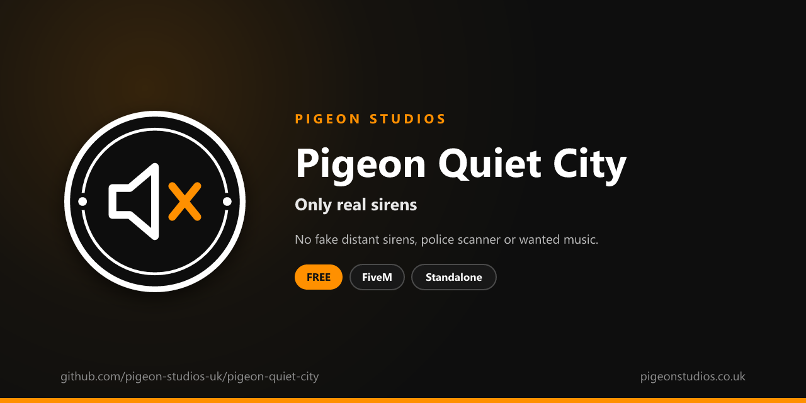

<div align="center">
  

  <h1>Pigeon Quiet City</h1>

  <p><strong>Turns off GTA's fake distant sirens, the police scanner voice, wanted music and flight music.</strong></p>

  <p>
    <a href="https://github.com/pigeon-studios-uk/pigeon-quiet-city/releases/latest"></a>
    <a href="LICENSE.md"></a>
    <a href="https://discord.gg/2NFVWEUmDF"></a>
    
  </p>

  <p>
    <a href="https://github.com/pigeon-studios-uk/pigeon-quiet-city/releases/latest"><strong>Download</strong></a> ·
    <a href="#installation">Install</a> ·
    <a href="#configuration">Configure</a> ·
    <a href="CHANGELOG.md">Changelog</a> ·
    <a href="https://discord.gg/2NFVWEUmDF">Support</a>
  </p>
</div>

---

## Contents

- [Overview](#overview)
- [Features](#features)
- [Requirements](#requirements)
- [Installation](#installation)
- [Updating](#updating)
- [Configuration](#configuration)
- [How it works](#how-it-works)
- [Update checker](#update-checker)
- [Performance](#performance)
- [Security](#security)
- [Troubleshooting](#troubleshooting)
- [FAQ](#faq)
- [Support](#support)
- [Contributing](#contributing)
- [Licence](#licence)
- [Credits](#credits)

## Overview

Pigeon Quiet City is a free resource by [Pigeon Studios](https://pigeonstudios.co.uk) that turns off GTA sounds that don't belong on a roleplay server. GTA plays sirens in the distance all the time, even when there isn't an emergency vehicle anywhere near. It reads out crimes over a police scanner, starts tense music when a player gets a wanted level, and plays music while flying. On roleplay servers those sounds make players think something is happening when nothing is, and talk over your players' radios.

With this resource, the only sirens players hear are real ones, and GTA's scanner and music stay quiet.

## Features

- **No fake distant sirens.** Real sirens on players' and NPCs' vehicles still play.
- **No police scanner.** The voice that reads out crimes, places and suspect descriptions.
- **No wanted music.** The music that starts with a wanted level.
- **No flight music.** The music that plays in planes and helicopters.
- **Any fixed sound source.** Turn off GTA's static sound emitters by name, such as the music in clubs.
- **Choose each one.** Keep any of them, or leave them to other resources.
- **Undoes itself.** Stopping the resource puts every sound back.
- **Standalone.** No framework or other resources needed.

## Requirements

| Requirement | Version | Notes |
|---|---|---|
| FXServer | A [recommended artifact](https://runtime.fivem.net/artifacts/) | |

**Frameworks:** none needed. It works the same on standalone servers, ESX Legacy, QBCore, Qbox and ox_core.

## Installation

1. **Download** `pigeon-quiet-city.zip` from the [latest release](https://github.com/pigeon-studios-uk/pigeon-quiet-city/releases/latest). Don't use the green **Code** button; release zips are the tested builds.
2. **Extract** it into your server's `resources` folder. The folder must be called `pigeon-quiet-city`.
3. **Start it** by adding this to `server.cfg`:

   ```cfg
   ensure pigeon-quiet-city
   ```

4. **Configure** it in `configuration/config.lua` if you want to change anything. The defaults work as they are.
5. **Restart** your server. The console shows one line from the update checker:

   ```text
   [Pigeon Studios] Pigeon Quiet City v1.0.0 is up to date.
   ```

## Updating

1. Read the [changelog](CHANGELOG.md) for every version between yours and the latest, especially any **Upgrade notes**.
2. Back up your `configuration/` folder.
3. Replace the `pigeon-quiet-city` folder with the new release.
4. Copy your changed settings into the new `configuration/config.lua`. Don't copy the old file over the new one; new versions can add settings.
5. Restart the resource.

## Configuration

All settings are in `configuration/config.lua`, each explained by a comment next to it.

| Setting | Default | What it does |
|---|---|---|
| `Config.DistantSirens` | `false` | GTA's fake sirens in the distance |
| `Config.PoliceScanner` | `false` | The police scanner voice |
| `Config.WantedMusic` | `false` | Music with a wanted level |
| `Config.FlightMusic` | `false` | Music while flying |
| `Config.StaticEmitters` | `{}` | Names of GTA's fixed sound sources to turn off |
| `Config.ReapplySeconds` | `1.0` | How often the settings are applied again |

For each sound, `false` turns it off, `true` keeps it, and `nil` leaves it to GTA and other resources.

Static emitters are GTA's fixed sound sources, such as radios and music in buildings. List the names to turn off. For example, the music in the Vanilla Unicorn:

```lua
Config.StaticEmitters = {
    'LOS_SANTOS_VANILLA_UNICORN_01_STAGE',
    'LOS_SANTOS_VANILLA_UNICORN_02_MAIN_ROOM',
    'LOS_SANTOS_VANILLA_UNICORN_03_BACK_ROOM',
}
```

## How it works

Each sound is a setting in each player's own game:

- `DistantCopCarSirens(false)` stops the fake sirens GTA plays far away. Sirens on real vehicles are separate and aren't touched.
- GTA's audio flags `PoliceScannerDisabled`, `WantedMusicDisabled` and `DisableFlightMusic` turn off the scanner and the music.
- `SetStaticEmitterEnabled` turns off each fixed sound source you list.

GTA can turn some of these back on, so they're applied again every `Config.ReapplySeconds`. When the resource stops, every sound is put back.

## Update checker

When it starts, Pigeon Quiet City checks our public [version registry](https://github.com/pigeon-studios-uk/pigeon-versions) once and prints one line in the server console saying whether it's up to date. If there's an update, it shows what's new and where to get it. The check is a single request to GitHub and sends nothing about your server or players.

Control it for every Pigeon Studios resource at once in `server.cfg`:

```cfg
set pigeon_update_check "on"      # default: one line per resource
set pigeon_update_check "quiet"   # only when there's an update or a problem
set pigeon_update_check "off"     # never check
```

## Performance

It sets a few audio settings once a second and does nothing else. Nothing runs every frame, and nothing runs on the server apart from the update check at start-up.

## Security

- It runs only in each player's own game and only changes what that player hears.
- It has no commands, exports or network events, so there is nothing other players, other resources or the server can send it.
- The only network request is the update check at start-up, from the server to GitHub. It sends nothing about your server or players.
- It's an audio setting, not a rule, so there's nothing for anyone to get around.

Found a problem? Please don't open a public issue. Use the **Report a vulnerability** button in this repository's **Security** tab, or follow our [Security Policy](https://github.com/pigeon-studios-uk/.github/blob/main/SECURITY.md).

## Troubleshooting

**I can still hear sirens.**
Real sirens on vehicles, players' and NPCs', are meant to play. If there are no emergency vehicles near and you still hear them, check the resource is started and there are no errors in the F8 console.

**A static emitter isn't turned off.**
Names must match GTA's exactly. Check the spelling, and that the sound is a static emitter rather than an NPC or a vehicle radio.

**The console says "isn't in the version registry" or "couldn't check for updates".**
Your server couldn't reach GitHub, or the check is blocked by a firewall. The resource works normally either way. Turn the check off with `set pigeon_update_check "off"`.

## FAQ

**Is it really free?**
Yes. Use it on as many servers as you like, including ones that take donations. You just can't reupload, resell or bundle it. See [Licence](#licence).

**Does it mute vehicle radios?**
No. Players' radios work as normal.

**Does it change NPC speech?**
No. NPCs talk as normal.

**Can I turn off AI police and ambulances too?**
That's [Pigeon No Wanted](https://github.com/pigeon-studios-uk/pigeon-no-wanted).

## Support

Read [Troubleshooting](#troubleshooting) first, then ask in the support channels of our [Discord](https://discord.gg/2NFVWEUmDF). Please include your Pigeon Quiet City version, FXServer artifact and any errors from the console. See [Getting help](https://github.com/pigeon-studios-uk/.github/blob/main/SUPPORT.md).

Found a bug? Open a [bug report](https://github.com/pigeon-studios-uk/pigeon-quiet-city/issues/new/choose).

## Contributing

Fixes, improvements and translations are welcome. Please read the [contributing guide](https://github.com/pigeon-studios-uk/.github/blob/main/CONTRIBUTING.md) first, and open a feature request before working on anything big.

## Licence

Pigeon Quiet City is free to use under the **[Pigeon Studios Free Licence](LICENSE.md)**.

- ✅ Use it on any number of servers, including monetised ones
- ✅ Change it for your own servers
- ✅ Show it in videos and streams
- ❌ Don't reupload, share or mirror the files; link to this repository instead
- ❌ Don't sell it, bundle it in packs, or put it behind escrow
- ❌ Don't remove the credits

This summary isn't the licence; [LICENSE.md](LICENSE.md) is. Third-party notices are in [NOTICE.md](NOTICE.md).

## Credits

Made by [Pigeon Studios](https://pigeonstudios.co.uk).

<sub>Not affiliated with or endorsed by Rockstar Games, Take-Two Interactive or Cfx.re.</sub>
